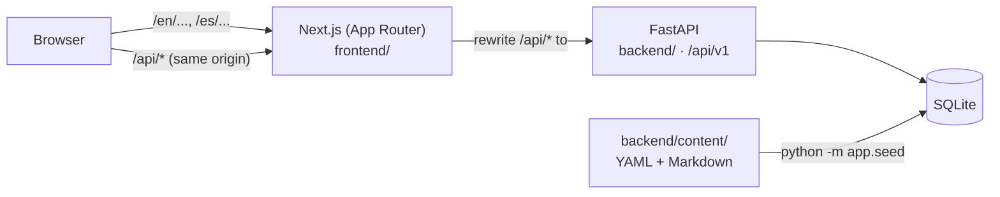
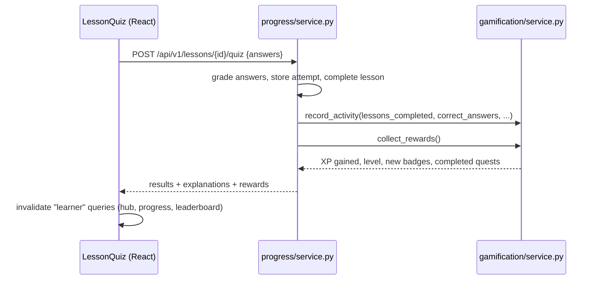

# Python Academy

**Learn programming with Python.** A free, bilingual (English / Spanish) and gamified
learning platform: short lessons with runnable examples, quizzes graded on the server,
XP, levels, badges, quests, a leaderboard and printable certificates.

The project is also a reference for a clean full-stack layout: a FastAPI backend split
by domain, and a Next.js frontend split by feature, both small enough to read in an afternoon.

## Features

- **Academy page** (public): hero, course catalogue with level, duration, lesson count and
  your progress when signed in, a "predict the output" demo quiz that needs no account,
  and a searchable A–Z glossary of 47 Python terms.
- **Four courses, 16 lessons**: Python Basics, Control Flow, Functions & Modules and Data
  Structures. Each lesson is Markdown with highlighted code, key takeaways and a 3-question quiz.
- **Exams and certificates**: each course ends with a 6-question exam, unlocked once every
  lesson is complete. Scoring 70% or more issues a printable certificate with a public
  verification ID.
- **Gamification**: XP for lessons, correct answers, perfect quizzes and exams; levels from
  XP thresholds; streaks; six badges; daily and weekly quests; weekly and all-time leaderboards
  that only show display names.
- **Learner hub**: level and XP bar, streak, quests, badges, "continue learning" and course progress.
- **Accounts**: sign up, log in, log out with server-side sessions in an `HttpOnly`,
  `SameSite=Lax` cookie. Passwords are hashed with Argon2, failed logins are rate-limited and
  bad credentials always return the same generic error.
- **Settings**: display name, language, theme, password change (requires the current password)
  and account deletion (requires the password and typing `DELETE`).
- **Two languages everywhere**: UI, lessons, quizzes, glossary, badges and quests exist in
  English and Spanish. The locale lives in the URL (`/en/...`, `/es/...`) and is saved to your
  settings when signed in.
- **Light and dark themes**: follows the system by default, can be switched manually, and is
  applied before the first paint so there is no flash.
- **Accessibility**: semantic landmarks, skip link, labelled controls, visible focus rings,
  `aria-live` quiz feedback, keyboard-only navigation, reduced-motion support and WCAG AA
  contrast in both themes (checked by a unit test).

## Architecture



- The browser only ever talks to the Next.js server. Next.js **rewrites** `/api/*` to FastAPI,
  so the session cookie is first-party and no CORS setup is needed.
- Course content lives in plain files (`backend/content`). A seed script loads it into SQLite;
  it is idempotent and keeps learner progress.
- Quiz and exam answers are **graded on the server**. Questions are sent without their answer
  key, which is only revealed in the grading response.
- Every learning action is written to an append-only `activity_events` table. XP totals,
  leaderboards, streaks, quest progress and badge rules are all computed from it, which keeps
  the gamification rules in one small module.

### Request flow: submitting a lesson quiz



### Security notes

- Session tokens are random 256-bit values; only their SHA-256 hash is stored.
- Changing the password signs out every other session. Deleting the account removes all of the
  user's data through `ON DELETE CASCADE`.
- State-changing requests must send an `X-Requested-With` header. Together with `SameSite=Lax`
  cookies this blocks cross-site request forgery: browsers cannot add custom headers to
  cross-site forms, and the API never approves the CORS preflight a cross-origin fetch would need.
- Errors use RFC 9457 problem details (`application/problem+json`).
- The login rate limiter is in memory, per process. That fits the single-process setup here;
  several API replicas would need a shared store such as Redis.

## Running it

### With Docker Compose

```bash
docker compose up --build
```

Open <http://localhost:3000>. The API docs are at <http://localhost:8000/docs>.
If those ports are taken, use `FRONTEND_PORT=3001 BACKEND_PORT=8001 docker compose up --build`.
The SQLite database is kept in the `academy-data` volume, and content is re-seeded on every start.

### Manually

Requirements: Python 3.12+, Node.js 24 and pnpm.

```bash
# Backend: http://127.0.0.1:8000 (docs at /docs)
cd backend
python3 -m venv .venv
.venv/bin/pip install -r requirements-dev.txt
.venv/bin/python -m app.seed          # creates data/academy.sqlite and loads the content
.venv/bin/uvicorn app.main:app --reload

# Frontend: http://localhost:3000 (in a second terminal)
cd frontend
pnpm install
pnpm dev                               # set BACKEND_URL if the API is not on 127.0.0.1:8000
```

Backend settings are environment variables with the `ACADEMY_` prefix; see
[`backend/.env.example`](backend/.env.example). Set `ACADEMY_COOKIE_SECURE=true` when serving over HTTPS.

The database is created with SQLAlchemy's `create_all` instead of migrations, which keeps the
project simple. If you change a model, delete `backend/data/academy.sqlite` and seed again
(or introduce Alembic once the schema needs to evolve with real data).

## Tests and quality checks

| Where     | Command                                  | What it covers |
|-----------|------------------------------------------|----------------|
| backend   | `.venv/bin/ruff check . && .venv/bin/ruff format --check .` | Lint and formatting |
| backend   | `.venv/bin/mypy`                         | Strict type checking |
| backend   | `.venv/bin/pytest`                       | Auth, settings, content integrity, courses, progress/XP/levels, badges, quests, streaks, leaderboards, exams and certificates (47 tests) |
| frontend  | `pnpm lint && pnpm format:check`         | ESLint (Next.js rules) and Prettier |
| frontend  | `pnpm typecheck`                         | TypeScript in strict mode |
| frontend  | `pnpm test`                              | Vitest + Testing Library: quiz form, demo quiz, API client, theme script, glossary search, identical en/es message keys and placeholders, colour-contrast of every token pair in both themes (64 tests) |
| frontend  | `pnpm build`                             | Production build |
| frontend  | `E2E_BASE_URL=http://localhost:3000 pnpm e2e` | Optional Playwright smoke test against a running stack: sign up, finish a lesson quiz, check the hub, switch to Spanish, dark mode, settings, log out |

GitHub Actions ([`.github/workflows/ci.yml`](.github/workflows/ci.yml)) runs the backend and
frontend checks on every push and pull request.

## Adding content

All content lives in [`backend/content`](backend/content). Run `python -m app.seed` (or restart
the Docker stack) after editing it.

**A lesson.** Add `courses/<course>/lessons/<lesson-slug>.en.md` and `<lesson-slug>.es.md`. Each
file starts with `# Title` and ends with a `## Key takeaways` (English) or `## Puntos clave`
(Spanish) section of `- ` bullets. Then list the lesson in the course's `course.yaml` with its
reading time and quiz:

```yaml
lessons:
  - slug: my-lesson
    minutes: 8
    quiz:
      - prompt: { en: What does this print?, es: ¿Qué imprime esto? }
        code: |
          print(1 + 1)
        options: { en: ["2", "11"], es: ["2", "11"] }
        answer: 0                 # zero-based index of the correct option
        explanation: { en: Integers add up., es: Los enteros se suman. }
```

**A course.** Create `courses/<slug>/course.yaml` with `slug`, `order`, `level`
(`beginner` or `intermediate`), bilingual `title` and `summary`, its `lessons` and an `exam`
(a list of questions in the same shape as quiz questions).

**Glossary terms, badges and quests** are in `glossary.yaml`, `badges.yaml` and `quests.yaml`.
Badges and quests are data-driven: each one names a metric (`lessons_completed`,
`correct_answers`, `perfect_quizzes`, `exams_passed`, `total_xp`, `streak_days`, `xp_earned`)
and a threshold.

`tests/test_content.py` fails if a lesson or question is missing a language.

## Adding a language

1. Backend: add the code to `LANGUAGES` and the `Lang` type in `app/core/i18n.py`, and to
   `TAKEAWAYS_HEADINGS` in `app/courses/content_loader.py`.
2. Content: add the new key next to every `en`/`es` value and a `<lesson>.<code>.md` file
   for every lesson.
3. Frontend: add the code to `locales` in `src/i18n/routing.ts`, the `Locale` type in
   `src/lib/api/types.ts`, and a `src/messages/<code>.json` catalogue. Add it to the
   catalogue test in `src/messages/messages.test.ts` so its keys are checked too.

## Project structure

```text
.
├── backend/
│   ├── app/
│   │   ├── main.py            # FastAPI app factory: middleware, errors, routers
│   │   ├── seed.py            # loads content/ into the database
│   │   ├── core/              # settings, database, problem+json errors, CSRF guard, i18n
│   │   ├── auth/              # sign up, log in/out, sessions, password hashing, rate limit
│   │   ├── users/             # profile, settings, password change, account deletion
│   │   ├── courses/           # courses, lessons, glossary, demo quiz, grading, content loader
│   │   ├── progress/          # quiz and exam submissions, course progress, certificates
│   │   └── gamification/      # XP, levels, streaks, badges, quests, leaderboards
│   ├── content/               # courses (YAML + Markdown), glossary, badges, quests, demo quiz
│   └── tests/                 # pytest suite (in-memory SQLite seeded with the real content)
├── frontend/
│   ├── e2e/                   # optional Playwright smoke test
│   └── src/
│       ├── app/[locale]/      # routes: academy, courses, lessons, exam, certificates, hub, ...
│       ├── features/          # one folder per screen, with its components and styles
│       ├── components/        # shared UI (buttons, fields, progress bar) and layout
│       ├── lib/api/           # fetch client, response types, TanStack Query hooks per domain
│       ├── i18n/ messages/    # next-intl routing and the en/es catalogues
│       ├── styles/            # design tokens, global and code-highlighting styles
│       └── theme/             # no-flash theme script and theme provider
├── docker-compose.yml
└── .github/workflows/ci.yml
```

Each backend domain has the same four files: `models.py` (tables), `schemas.py` (API shapes),
`service.py` (logic) and `router.py` (HTTP endpoints).

## Design

The palette is built from four colours: lavender `#CCABD8`, muted purple `#8474A1`, teal
`#08979D` and deep teal `#045A5C`. Components only use semantic tokens (`--color-bg`,
`--color-surface`, `--color-text`, `--color-muted`, `--color-primary`, `--color-accent`,
`--color-focus`, ...) defined in [`src/styles/tokens.css`](frontend/src/styles/tokens.css),
with separate values for the dark theme.

Teal `#08979D` on white is below 4.5:1, so light-mode text and buttons use deep teal
`#045A5C`, and dark mode uses a light teal tint. `tokens.test.ts` computes the contrast ratio
of every text/background pair (and the syntax-highlighting colours) in both themes.

## License

[MIT](LICENSE) © 2026 Franciellen Gonçalves
